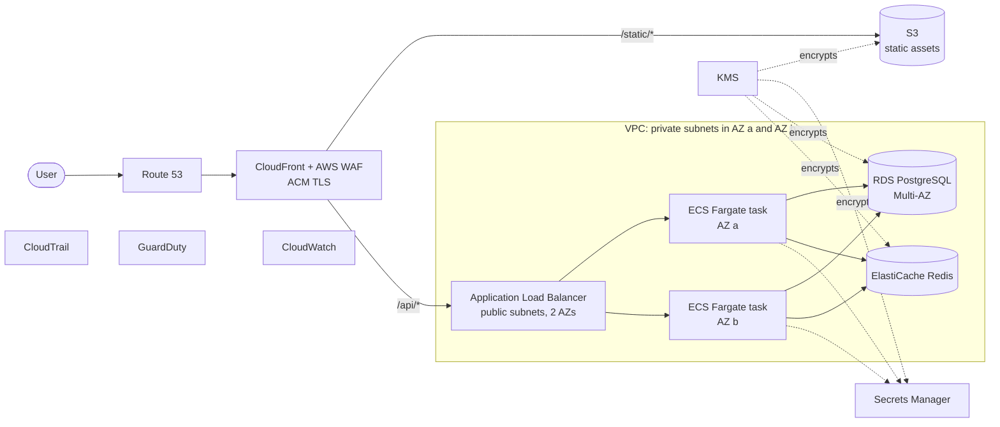

# aws-ha-web-platform

A highly available web platform on AWS, defined entirely in CloudFormation, running a small Node.js/Express API on ECS Fargate across two Availability Zones.

> **Status:** work in progress. Sections marked _TBD_ will be filled in as each stack is built. Every figure in this README (cost, deploy time, failover time) is measured, not estimated, and says how it was measured.

## Contents

- [Problem](#problem)
- [Architecture](#architecture)
- [Design decisions and trade-offs](#design-decisions-and-trade-offs)
- [Security](#security)
- [Observability](#observability)
- [Reliability testing](#reliability-testing)
- [Cost](#cost)
- [Run locally](#run-locally)
- [Repository layout](#repository-layout)
- [Deploy and teardown](#deploy-and-teardown)
- [CI/CD](#cicd)
- [What I'd do next](#what-id-do-next)

## Problem

I wanted a production-shaped reference platform for a stateless backend API, one that:

- survives the loss of a container, an instance or a whole Availability Zone without downtime;
- keeps the application and data off the public internet, with encryption at rest and in transit;
- is reproducible from code, deployable from CI without long-lived AWS credentials, and can be torn down completely in one command;
- tells me when something is wrong before a user does.

The API itself is deliberately small, so the focus stays on the infrastructure around it. It is a notes service in Node.js 22 and Express 5, backed by PostgreSQL with a Redis cache-aside layer:

| Method and path | Purpose |
|---|---|
| `GET /health` | Liveness for the ALB. Does not touch dependencies, so a database failover does not make the ALB drain every task. |
| `GET /ready` | Readiness: checks PostgreSQL (required) and Redis (optional). Returns 503 if the database is unreachable. |
| `POST /api/notes` | Create a note (`title`, optional `content`). |
| `GET /api/notes` | List recent notes (`?limit=`, max 100). |
| `GET /api/notes/:id` | Read a note through the cache. The `X-Cache: HIT|MISS` header shows which path served it. |
| `DELETE /api/notes/:id` | Delete a note and invalidate its cache entry. |

Behaviours that matter for the platform:

- **Redis is optional.** If ElastiCache is unavailable, requests fall through to PostgreSQL and a warning is logged. An integration test covers this.
- **Graceful shutdown.** On SIGTERM (sent by ECS when a task stops), the server stops accepting connections, finishes in-flight requests, and closes its pools.
- **Safe concurrent start-up.** Schema migrations run at start-up under a PostgreSQL advisory lock, so several tasks starting at once do not race.
- **Structured logs.** One JSON line per request on stdout, keyed by the ALB trace id when present.

## Architecture

### Built so far


Nothing is deployed to AWS yet. PostgreSQL and Redis stand in locally for RDS and ElastiCache. This diagram is updated as each stack lands.

### Target

<!-- TBD: replace with a full-size exported diagram in docs/images/architecture.png -->



| Stack | Template | Contents |
|---|---|---|
| network | `infra/templates/network.yaml` | VPC, public / private / data subnets in two AZs, NAT Gateways, VPC endpoints, flow logs |
| data | `infra/templates/data.yaml` | KMS key, RDS PostgreSQL Multi-AZ, ElastiCache Redis, Secrets Manager secret |
| compute | `infra/templates/compute.yaml` | ECR, ALB, ECS cluster and Fargate service, auto scaling, task and execution roles |
| edge | `infra/templates/edge.yaml` | CloudFront, WAF web ACL, ACM certificate, Route 53 records, S3 static bucket |
| security | `infra/templates/security.yaml` | CloudTrail, GuardDuty |
| observability | `infra/templates/observability.yaml` | CloudWatch dashboard, alarms, SNS topic |

## Design decisions and trade-offs

_TBD as each stack lands. Planned topics:_

- **Fargate over EC2:** no instances to patch or bin-pack. The trade-off is a higher per-vCPU price and less control over the host.
- **Multi-AZ RDS:** synchronous standby and automatic failover, at roughly double the database cost.
- **CloudFront in front of the ALB:** TLS at the edge, caching, WAF at the edge, and an ALB that only accepts traffic from CloudFront.
- **NAT Gateway per AZ vs one shared:** availability against cost.
- **CloudFormation over CDK/Terraform:** _TBD_
- **Region choice:** _TBD_

## Security

Summary here, detail in [SECURITY.md](SECURITY.md). _TBD_

## Observability

_TBD: dashboard screenshot, alarm list, log format._

## Reliability testing

_TBD: documented tests for (1) stopping a running task, (2) forcing an RDS Multi-AZ failover, with measured results._

## Cost

_TBD: measured monthly cost per environment, with the AWS Pricing Calculator link and Cost Explorer figures._

## Repository layout

```
app/                    Node.js/Express API and Dockerfile
infra/templates/        CloudFormation templates, one per stack
infra/parameters/       Parameter files per environment (dev, prod)
scripts/                deploy, destroy and lint scripts used by make and CI
docs/                   Diagrams, screenshots, runbooks
.github/workflows/      CI/CD pipelines
```

## Run locally

Needs Docker and Node.js 22. PostgreSQL and Redis run in containers on ports 5442 and 6389, so they do not clash with local installs.

```sh
docker compose up -d --wait               # PostgreSQL and Redis
cd app && npm ci && npm test              # lint separately with: npm run lint
docker compose --profile app up --build   # API on http://localhost:3000
```

## Deploy and teardown

_TBD._ The intended interface:

```sh
make lint                 # cfn-lint + Checkov on all templates
make deploy ENV=dev       # deploy every stack in order
make destroy ENV=dev      # delete every stack in reverse order
```

On Windows without `make`, use the scripts directly, e.g. `bash scripts/deploy.sh dev`.

## CI/CD

_TBD: GitHub Actions with OIDC role assumption, no stored access keys._

## What I'd do next

_TBD: multi-region active/passive, blue/green deployments with CodeDeploy, EKS variant._

## Licence

[MIT](LICENSE)
