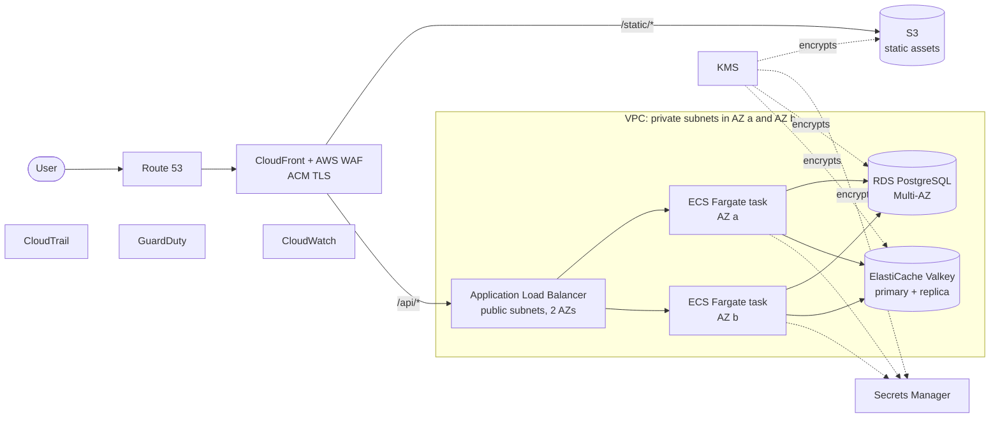

# aws-ha-web-platform

A highly available web platform on AWS, defined entirely in CloudFormation, running a small Node.js/Express API on ECS Fargate across two Availability Zones.

> **Status:** work in progress. Sections marked _TBD_ will be filled in as each stack is built. Every figure in this README (cost, deploy time, failover time) is measured, not estimated, and says how it was measured.

## Contents

- [Problem](#problem)
- [Architecture](#architecture)
- [Design decisions and trade-offs](#design-decisions-and-trade-offs)
- [Security](#security)
- [Observability](#observability)
- [Reliability testing](#reliability-testing)
- [Cost](#cost)
- [Run locally](#run-locally)
- [Repository layout](#repository-layout)
- [Deploy and teardown](#deploy-and-teardown)
- [CI/CD](#cicd)
- [What I'd do next](#what-id-do-next)

## Problem

I wanted a production-shaped reference platform for a stateless backend API, one that:

- survives the loss of a container, an instance or a whole Availability Zone without downtime;
- keeps the application and data off the public internet, with encryption at rest and in transit;
- is reproducible from code, deployable from CI without long-lived AWS credentials, and can be torn down completely in one command;
- tells me when something is wrong before a user does.

The API itself is deliberately small, so the focus stays on the infrastructure around it. It is a notes service in Node.js 22 and Express 5, backed by PostgreSQL with a Redis cache-aside layer:

| Method and path | Purpose |
|---|---|
| `GET /health` | Liveness for the ALB. Does not touch dependencies, so a database failover does not make the ALB drain every task. |
| `GET /ready` | Readiness: checks PostgreSQL (required) and Redis (optional). Returns 503 if the database is unreachable. |
| `POST /api/notes` | Create a note (`title`, optional `content`). |
| `GET /api/notes` | List recent notes (`?limit=`, max 100). |
| `GET /api/notes/:id` | Read a note through the cache. The `X-Cache: HIT|MISS` header shows which path served it. |
| `DELETE /api/notes/:id` | Delete a note and invalidate its cache entry. |

Behaviours that matter for the platform:

- **Redis is optional.** If ElastiCache is unavailable, requests fall through to PostgreSQL and a warning is logged. An integration test covers this.
- **Graceful shutdown.** On SIGTERM (sent by ECS when a task stops), the server stops accepting connections, finishes in-flight requests, and closes its pools.
- **Safe concurrent start-up.** Schema migrations run at start-up under a PostgreSQL advisory lock, so several tasks starting at once do not race.
- **Structured logs.** One JSON line per request on stdout, keyed by the ALB trace id when present.

## Architecture

### Built so far


Nothing is deployed to AWS yet. PostgreSQL and Redis stand in locally for RDS and ElastiCache. All the stacks in [`infra/templates/`](infra/templates/), the deploy and teardown scripts and the CI workflow are written and pass lint, but nothing has been deployed. This diagram is updated as each stack lands.

### Target

<!-- TBD: replace with a full-size exported diagram in docs/images/architecture.png -->



| Stack | Template | Contents |
|---|---|---|
| network | `infra/templates/network.yaml` | VPC, public / private / data subnets in two AZs, NAT Gateways, VPC endpoints, flow logs |
| data | `infra/templates/data.yaml` | KMS key, RDS PostgreSQL Multi-AZ, ElastiCache for Valkey, Secrets Manager secrets, app/database/cache security groups |
| registry | `infra/templates/registry.yaml` | ECR repository for the API image |
| compute | `infra/templates/compute.yaml` | ALB, ECS cluster and Fargate service, auto scaling, migration task, task and execution roles, app log group |
| dns | `infra/templates/dns.yaml` | Route 53 hosted zone for the platform subdomain (prod) |
| edge-global | `infra/templates/edge-global.yaml` | us-east-1: CloudFront viewer certificate, WAF web ACL (prod) |
| edge | `infra/templates/edge.yaml` | CloudFront distribution, private S3 static bucket, Route 53 records |
| logging | `infra/templates/logging.yaml` | Access-log bucket for the ALB, CloudFront and S3 |
| security | `infra/templates/security.yaml` | Once per account: CloudTrail, GuardDuty, finding alerts |
| observability | `infra/templates/observability.yaml` | CloudWatch alarms, alarm topic, dashboard |

## Design decisions and trade-offs

Prices quoted below are AWS on-demand list prices for eu-west-1, taken from the AWS Price List on 13 November 2026. They are not measured spend; that goes in [Cost](#cost) once the platform has run.

### Region

Everything runs in **eu-west-1 (Ireland)**, with one exception that AWS imposes: CloudFront only accepts an ACM certificate from **us-east-1**, and a WAF web ACL with `CLOUDFRONT` scope must also be created there. The edge stack therefore deploys that certificate and web ACL to us-east-1 and everything else to eu-west-1.

### Network (`infra/templates/network.yaml`)

- **Three subnet tiers in two AZs.** Public subnets hold only the ALB and the NAT Gateways. Private-app subnets hold the Fargate tasks. Private-data subnets hold RDS and ElastiCache and have **no default route at all**, so even a misconfigured database cannot reach the internet. Each tier gets a /24 per AZ, carved from a /16 with `Fn::Cidr`, which leaves room for more tiers later.
- **No public IPs by default.** No subnet sets `MapPublicIpOnLaunch`. The NAT Gateways use Elastic IPs and the ALB manages its own addresses, so nothing else can end up with a public IP by accident.
- **NAT: managed gateways in prod, one small NAT instance in dev** (`NatMode`, `NatCount`). A NAT Gateway costs $0.048/hour plus $0.048 per GB processed. A `t4g.nano` NAT instance costs $0.0046/hour plus $0.70 a month for its 8 GB gp3 disk, with no per-GB charge. Either way, each NAT needs a public IPv4 address at $0.005/hour, which makes the address the largest part of dev's network cost. The instance runs Amazon Linux 2023 and does NAT with a single iptables `MASQUERADE` rule set up in user data. It has no SSH key, no inbound SSH, IMDSv2 only and an encrypted disk, and I reach it through SSM Session Manager. What I give up in dev:
  - The instance is not self-healing. If it fails, the private-app subnets lose outbound internet until I replace it. Routes point at a fixed network interface rather than at the instance, so a replacement only needs that interface reattached.
  - Its bandwidth is that of a `t4g.nano`, which is plenty for test traffic.
  - I own its OS patching.

  In prod, `NatCount` 2 gives each AZ its own managed gateway, so losing an AZ only affects that AZ. With a single NAT in AZ a, losing AZ a would also cut outbound access for AZ b. Each private-app subnet has its own route table in every mode, so switching between modes or counts only changes route targets, and the Elastic IPs stay the same.
- **S3 gateway endpoint everywhere.** It is free, and ECR stores image layers in S3, so image pulls do not pay the NAT Gateway's per-GB charge. Its endpoint policy only allows `s3:GetObject` on the ECR layer bucket for the Region, because nothing else in the VPC needs S3.
- **Interface endpoints only in prod** (`EnableInterfaceEndpoints`). Fargate needs ECR (`ecr.api`, `ecr.dkr`), CloudWatch Logs and Secrets Manager. Four endpoints in two AZs cost 8 × $0.011 = $0.088/hour (about $64 a month) plus $0.01 per GB. The NAT instance that dev needs anyway already reaches those APIs, so in dev the endpoints would add cost without removing anything. On cost alone, they only pay off against NAT processing ($0.048 vs $0.01 per GB) above roughly 1.7 TB a month, far beyond this project's traffic. I enable them in prod for a different reason: image pulls, secret retrieval and log delivery stay on the AWS network, and do not depend on NAT.
- **Logging: full in prod, minimal in dev** (`LoggingMode`). In prod, VPC flow logs capture accepted and rejected traffic for the whole VPC into a CloudWatch Logs group with 365-day retention. The group is encrypted with a customer-managed KMS key ($1 a month, rotated yearly). Ingestion is the main variable cost at $0.57 per GB, so the aggregation interval stays at the default 10 minutes. The same key is exported for the application's log groups, so prod pays for one logs key rather than one per stack. Dev has no flow logs and no key: application logs use CloudWatch Logs' default encryption, which is free. Dev only carries my own test traffic, so I don't need flow logs there for investigation.
- **Cross-stack wiring through exports** named `<stack>-VpcId`, `<stack>-PrivateAppSubnetIds` and so on. The later stacks take the network stack name as a parameter and use `Fn::ImportValue`, and CloudFormation refuses to delete the network stack while anything still imports from it.

### Data (`infra/templates/data.yaml`)

At list prices, over a 730-hour month, the data stack comes to about **$26.68 a month in dev** (about $0.037/hour) and **$77.11 in prod** (about $0.106/hour). Together with the network stack, that is $34.39 in dev and $219.71 in prod.

- **PostgreSQL 17 on RDS: single-AZ `db.t4g.micro` in dev, Multi-AZ `db.t4g.small` in prod** (`DbInstanceClass`, `DbMultiAz`). The micro costs $0.017/hour single-AZ. The small costs $0.069/hour Multi-AZ: twice its single-AZ price, because the standby is a full second instance in the other AZ, kept in sync and promoted automatically if the primary or its AZ fails. gp3 storage is $0.127 per GB-month, or $0.254 for Multi-AZ, and 20 GiB is the minimum. For prod I passed over `db.t4g.micro` (1 GiB of memory, little for PostgreSQL) and the larger `db.t4g.medium` ($0.138/hour Multi-AZ) and `db.m7g.large` ($0.372/hour Multi-AZ), which are out of proportion for a demo that runs on credits. What I give up in dev is failover: if the instance or AZ a fails, the API is down until RDS recovers it. The t4g classes run in unlimited CPU-credit mode, so sustained load above the baseline is billed per surplus vCPU-hour ($0.075 or $0.09 in the price list).
- **TLS required, storage encrypted.** The parameter group sets `rds.force_ssl=1`, so plaintext connections are refused. The app verifies the server certificate against the RDS CA bundle in its image, and the instance pins `rds-ca-rsa2048-g1` to match. Storage, automated backups and Performance Insights data are encrypted with the data tier's KMS key.
- **No password in the template.** With `ManageMasterUserPassword`, RDS generates the master password, keeps it in a Secrets Manager secret encrypted with the data key ($0.40 a month) and rotates it every 7 days. Only the one-off migration task ever reads this secret. The API service connects as a separate, less privileged user with IAM authentication (see Compute), so the 7-day rotation never interrupts it.
- **Backups and deletion differ per environment.** Dev keeps backups for 1 day, has no deletion protection, and the database is deleted with the stack. Prod keeps 7 days, has deletion protection on, and takes a final snapshot when the stack deletes or replaces the instance. Backup storage up to the size of the database is free, then $0.095 per GB-month. Choosing the `DeletionPolicy` from a parameter needs the `AWS::LanguageExtensions` transform, so this stack deploys with `CAPABILITY_AUTO_EXPAND`. When the policy is `Snapshot`, the KMS key is retained too, because the snapshot cannot be restored without it. After a prod teardown, that key keeps costing $1 a month until I schedule its deletion.
- **Monitoring.** Enhanced Monitoring sends OS metrics every 60 seconds in both environments. Its only cost is CloudWatch Logs ingestion ($0.57 per GB), which I will measure rather than guess. Prod also turns on Performance Insights with the free 7-day retention, and exports the PostgreSQL log to a log group the stack creates itself, with 90-day retention and the network stack's logs key. Statements slower than 1 second are logged.
- **ElastiCache for Valkey rather than Redis OSS.** Valkey speaks the same protocol, so the app's `redis` client needs no change, and a `cache.t4g.micro` node costs $0.0136/hour against $0.017 for Redis OSS (20% less). I use Valkey 8.2. Valkey Serverless would be cheaper for dev (its 100 MB minimum at $0.094 per GB-hour is about $6.86 a month), but it is a different resource with different behaviour. I prefer dev to run the same template as prod.
- **One cache node in dev, a primary and a replica in prod** (`CacheNodeCount`), on `cache.t4g.micro` either way. In prod the replica sits in the other AZ, and ElastiCache promotes it automatically if the primary fails. The cache only holds data derived from PostgreSQL, and the app treats it as optional, so losing the dev node costs latency, not availability. Prod keeps one daily snapshot; dev keeps none.
- **Cache TLS and AUTH.** In-transit encryption is set to `required` and at-rest encryption uses the data key. The AUTH token (64 letters and digits) is generated by Secrets Manager and passed to ElastiCache through a dynamic reference, so it never appears in the template or the parameters. The app connects with a `rediss://` URL, which makes the `redis` client use TLS. ElastiCache's certificate comes from Amazon's public CA, which Node already trusts. The token reaches the app as `REDIS_PASSWORD`, which ECS will inject from the secret. It cannot go into the URL secret, because that secret is created before the cache endpoint exists. I chose a single AUTH token over RBAC users because there is only one client. The token is not rotated automatically yet.
- **One KMS key for the whole data tier** ($1 a month, rotated yearly). It covers the database, the cache, both secrets and Performance Insights. It is separate from the network stack's logs key, whose policy only lets CloudWatch Logs use it. Each rotation adds a key version, billed at $1 a month, and AWS stops charging for new versions after the second rotation.
- **The app's security group lives in this stack.** The database and cache groups accept 5432 and 6379 only from the app group, and have no egress rules at all. The app group has to exist before those rules, and the compute stack does not exist yet, so this stack creates and exports it. The compute stack attaches it to the Fargate service and adds the ALB-to-app rule as a separate ingress resource. This stack defines no ingress on the app group, so the two stacks never manage the same rules. The app group's egress to 5432 and 6379 targets the VPC CIDR rather than the data groups. Referencing those groups would create a dependency loop, and it adds no exposure, because nothing but the app group is accepted on those ports.

### Registry and compute (`infra/templates/registry.yaml`, `infra/templates/compute.yaml`)

At list prices, the compute stack adds about **$33.31 a month in dev** (about $0.045/hour) and **$54.94 in prod** (about $0.075/hour). Traffic-based charges (load balancer capacity units, log ingestion, ECR storage) are left out; at test traffic they come to cents. With the network and data stacks, that makes about $67.70 a month in dev and $274.65 in prod.

- **Fargate rather than EC2.** There are no instances to patch or pack containers onto. The trade-off is a higher price per vCPU and less control over the host.
- **Graviton (Arm64) tasks: 0.25 vCPU and 0.5 GB in dev, 0.5 vCPU and 1 GB in prod.** Arm64 costs $0.03238 per vCPU-hour and $0.00356 per GB-hour, about 20% less than x86 ($0.04048 and $0.004445). That makes a dev task $0.0099/hour and a prod task $0.0198/hour. The cost is building a `linux/arm64` image: `docker buildx` does it under emulation on my x86 machine, and I checked that the image starts with the task's read-only root filesystem.
- **One task per AZ in prod, scaling on CPU.** Prod runs at least 2 tasks and at most 4; dev runs 1 or 2. Target tracking aims for 60% average CPU. ECS spreads the tasks across the private-app subnets in both AZs, so losing a task or an AZ leaves one serving while a replacement starts. Deployments start new tasks before stopping old ones, and ECS rolls back automatically if the new ones fail their health checks.
- **Draining on shutdown.** When ECS stops a task, it first removes it from the load balancer and waits 30 seconds, then sends SIGTERM and allows 30 seconds more. The app stops accepting connections, finishes in-flight requests and exits within 20 seconds. The ALB health check calls `/health`, which never touches the database, so a database failover does not take every task out of service.
- **The load balancer only answers CloudFront.** Its security group admits only AWS's managed CloudFront origin-facing prefix list. Other CloudFront distributions share those addresses, so the listener also requires an `X-Origin-Verify` header. Its value is generated by Secrets Manager, and the edge stack makes CloudFront send it. Anything else gets a 403. The ALB itself costs $0.0252/hour, plus $0.008 per capacity unit-hour of traffic, plus two public IPv4 addresses at $0.005/hour each (one per AZ). That is $25.70 a month before traffic, more than dev's single task. I keep it in dev anyway, so dev keeps the same request path as prod.
- **HTTPS from CloudFront to the ALB is required in prod.** Given the dns stack (`DnsStackName`), compute issues an ACM certificate for `origin.<domain>`, which ACM validates and renews through the hosted zone. It also points that name at the ALB, and serves HTTPS on 443 with a TLS 1.2+ policy. CloudFront connects to that name, so the certificate it checks matches. Dev has no domain, so it serves HTTP on 80 with the ALB's own DNS name. A CloudFormation rule refuses to deploy prod without a domain.
- **No database password in the service.** The API connects as `notes_app` using IAM database authentication. For each new connection it signs a 15-minute token with the task role's credentials; signing is a local computation. The task role can do exactly one thing: `rds-db:connect` as that user on that instance. `notes_app` can read and write rows in the app's tables, but it cannot create, alter or drop anything, or read the migration history. This also removes the rotation problem: RDS rotates the master password every 7 days, and ECS only injects secrets when a task starts.
- **Migrations run as their own task.** The same image with a different command (`node src/migrate.js`) runs as a one-off ECS task. It uses the master secret to apply migrations and keep `notes_app` and its grants current. The deploy order is: push the image, run the migration task, then update the service. On the very first deploy the service is created with no tasks (`ServiceEnabled=false`), so that the migration task can create `notes_app` before any task tries to log in as it. Locally, the server still applies migrations at start-up (`MIGRATE_ON_START`).
- **Two execution roles.** The service's execution role can pull the image, write to its log group and read the Valkey token. The migration task's role can read the master secret instead. Both can decrypt with the data key only through Secrets Manager (`kms:ViaService`). The long-running service therefore never holds the master password, even indirectly.
- **ECR in its own stack.** The repository is deployed before compute, so an image can be pushed before the service exists, and images survive a compute teardown. Tags are immutable, so a task definition that names a tag (the commit SHA) always runs exactly what was tested. Images are scanned on push. Untagged images expire after a day, and only the last 10 tagged images are kept, at $0.10 per GB-month. The image is about 64 MB.
- **Things I left off for now.** Container Insights stays off until I have measured what it costs, since it is billed per metric or per observation. The free ECS service CPU and memory metrics already drive auto scaling. Fargate Spot is not in the AWS Price List, because its price varies, so I have not priced it.

### Edge (`infra/templates/dns.yaml`, `edge-global.yaml`, `edge.yaml`)

At list prices, the edge adds about **$0 a month in dev** and **$9.50 in prod** (about $0.013/hour): a hosted zone at $0.50 and WAF at $9, and ACM's public certificates are free. CloudFront's always-free tier covers 1 TB of data out and 10 million requests a month, far more than test traffic. With the other stacks, that makes about $67.70 a month in dev and $284.15 in prod.

- **CloudFront in front of everything.** Viewers get TLS at the nearest edge location, and only CloudFront can reach the ALB. `/api/*` and every other path not under `/static/` go to the ALB, never cached, with all HTTP methods and the viewer's headers except `Host`. CloudFront adds the secret `X-Origin-Verify` header. `/static/*` comes from S3, cached with AWS's `CachingOptimized` policy. Viewers on HTTP are redirected to HTTPS, HTTP/2 and HTTP/3 are on, and AWS's managed security-headers policy adds HSTS, `X-Content-Type-Options`, `X-Frame-Options` and `Referrer-Policy`. Price class 100 (North America and Europe edge locations) fits a platform hosted in Ireland.
- **Three stacks, because of one Region rule.** CloudFront only accepts a viewer certificate and a WAF web ACL from us-east-1. So `edge-global` holds just those two, in us-east-1. Everything else stays in eu-west-1: the `dns` stack's hosted zone, and the `edge` stack with the distribution, bucket and records. CloudFront is global, so a eu-west-1 stack can create the distribution, which lets it read the origin-header secret from eu-west-1 with a dynamic reference. Exports cannot be imported across Regions. The deploy script therefore passes the certificate ARN, web ACL ARN and hosted zone id between Regions, none of which is secret. The secret itself never leaves eu-west-1, so it needs no replica (which would cost $0.40 a month).
- **A delegated subdomain, not the whole domain.** The parent domain stays at its current DNS provider. The dns stack hosts only `platform.<domain>` ($0.50 a month), and I delegate it by adding the zone's four name servers as NS records at the parent. The domain is a deploy-time parameter and is never committed.
- **Dev has no domain and no WAF.** It uses the distribution's `*.cloudfront.net` name with CloudFront's default certificate, and HTTP from CloudFront to the ALB, with the origin header still required. That saves the hosted zone, the certificates and WAF's $9 a month; dev only carries my test traffic. Template rules refuse to deploy prod without the domain, the certificate and the web ACL.
- **WAF: three AWS managed rule groups and a rate limit.** In priority order:
  1. Amazon's IP reputation list, which blocks known botnets and scanners before anything else runs.
  2. A per-IP rate limit of 1,000 requests in any 5 minutes.
  3. The common rule set (OWASP-style protections such as XSS and path traversal). Its 8 KB body limit is set to count, not block, because a valid note can be larger; the API rejects bodies over 32 KB itself.
  4. Known bad inputs, which covers exploit patterns such as Log4j.

  WAF costs $5 per web ACL plus $1 per rule or rule group each month, plus $0.60 per million requests. These four came to $9 a month, against $7 for the common rule set and rate limit alone. Blocked and counted requests are logged (see below); sampled requests and metrics are on too.
- **Private static bucket.** Block Public Access is on, ACLs are disabled, there is no website hosting, and HTTPS is required. The bucket policy lets only this distribution read objects (origin access control: CloudFront signs every request with SigV4). Versioning lets me roll back a bad upload, and old versions expire after 30 days. Objects use SSE-S3 rather than a customer-managed KMS key: the files are public web content served to anyone through CloudFront, so a $1-a-month key and a CloudFront key policy would protect nothing. The bucket holds one small page ([`static/index.html`](static/index.html)) describing the API, so the S3 path is real and testable.

### Security and observability (`logging.yaml`, `security.yaml`, `observability.yaml`, WAF logs in `edge-global.yaml`)

At list prices, this adds about **$4.10 a month in dev** and **$5.30 in prod**, plus **about $1 a month once for the account** and GuardDuty's usage charges. With everything else, that makes about $71.80 a month in dev and $289.45 in prod. The account-level stack is billed once, whichever environments are up.

- **CloudTrail and GuardDuty are per account, not per environment.** Dev and prod share one AWS account. A second trail would bill a second copy of every management event ($0.00002 each), and GuardDuty allows one detector per Region anyway. So `security.yaml` is deployed once, and covers both environments.
- **CloudTrail.** One trail records management events in every Region, including us-east-1, where the edge pieces live. It includes global services such as IAM, STS and CloudFront. The first copy of management events is free. Log file validation writes signed digest files, so I can prove a log was not changed or deleted. The logs go to an audit bucket encrypted with a customer-managed key ($1 a month), which only CloudTrail and GuardDuty may use, each for its own resources. The bucket is versioned, keeps logs for 365 days, and is retained if the stack is deleted, along with its key. Data events (individual S3 and Lambda calls) are not recorded; they cost $0.10 per 100,000 and nothing here needs them.
- **GuardDuty.** The detector analyses CloudTrail management events ($4.40 per million), VPC flow logs and DNS logs ($1.10 per GB) for this account. GuardDuty offers a 30-day free trial, and I will measure the real charge during the deploy sessions. Its optional plans are listed explicitly as disabled, so no account default can switch one on and bill it silently: S3 data events, RDS login events, EBS malware scanning, EKS and Lambda. Runtime Monitoring for Fargate is a parameter, off for now. It costs $1.50 per vCPU-month and adds an agent sidecar to every task, and dev's 0.5 GB tasks have little memory to spare. Findings are exported to the audit bucket. Findings of medium severity or higher (4.0 and above) go through EventBridge to an SNS topic encrypted with the same key, which emails me a one-line summary. The address is a deploy-time parameter and is never committed.
- **Access logs, in one bucket per environment.** The ALB, CloudFront (standard logs) and the static bucket all log to a bucket in `logging.yaml`, deployed right after the network, so the other stacks can switch logging on when they are created. Delivery to S3 is free for all three, and storage is $0.023 per GB-month. Logs expire after 30 days in dev and 365 in prod. The bucket uses SSE-S3, because ALB access logs cannot be delivered to a KMS-encrypted bucket. It also keeps ACLs enabled, because CloudFront's free standard logs write objects with an ACL. The newer CloudFront logging avoids ACLs, but it costs $0.25 per GB and has to be configured in us-east-1 after the distribution exists. Only the ELB log delivery account for eu-west-1 and the S3 logging service may write here, each under its own prefix.
- **WAF logs: blocked and counted requests only.** AWS requires WAF's log destination to be in the web ACL's Region, so the log group is in us-east-1, in `edge-global`. It must be named `aws-waf-logs-*`, has 90-day retention, and is encrypted with its own key ($1 a month). The eu-west-1 logs key cannot be used across Regions. Allowed requests already appear in the ALB and CloudFront logs, so a filter keeps only blocked and counted ones, at $0.57 per GB ingested.
- **Alarms on what users notice first.** All alarms use the free default metrics, at $0.10 each a month: 11 in dev and 13 in prod.
  - ALB: 5xx returned by the load balancer, 5xx returned by the API, and p95 response time above 1 second for 3 minutes.
  - Fewer healthy tasks than the service minimum, for 3 minutes. Without Container Insights there is no running-task metric, so this uses healthy targets.
  - Service CPU or memory above 85% for 15 minutes, which means auto scaling has run out of room.
  - Database CPU above 80%, free storage below 2 GiB, and more than 60 connections. The pools allow at most 10 per task, so more than 60 means a leak or an unexpected client.
  - Valkey engine CPU and memory, on each node.

  Each alarm notifies on both trigger and recovery, by email through an SNS topic. That topic uses SNS's default encryption rather than a customer-managed key. CloudWatch alarms cannot publish to a topic encrypted with the AWS-managed SNS key, and alarm messages hold only alarm names and numbers.
- **One dashboard per environment** ($3 a month) shows the same signals on one page: requests and errors, p50/p95/p99 latency, healthy tasks, service CPU and memory, database CPU and connections, cache hits and misses, and every alarm's state.

### CI/CD and deploy access (`cicd.yaml`, `.github/workflows/`, `scripts/`)

- **No AWS keys in GitHub.** The deploy workflow asks GitHub for an OIDC token, and STS exchanges it for a role session of at most two hours (a first prod deploy waits on RDS Multi-AZ and CloudFront). Each environment's deploy role trusts exactly one subject, `repo:pimentafonso/aws-ha-web-platform:environment:<env>`, with the audience `sts.amazonaws.com`. A fork, another repository, or a job outside that GitHub environment gets nothing. The subjects are stack parameters, so they could be narrowed further (for example to a single branch) without editing the template.
- **One OIDC provider per account, so creating it is optional.** AWS allows one `token.actions.githubusercontent.com` provider per account. `CreateOidcProvider=false` with `ExistingOidcProviderArn` reuses one that already exists. AWS validates GitHub's tokens against its own trusted CAs, so no certificate thumbprint is pinned.
- **Two roles per environment.** The GitHub deploy role can do very little by itself:
  - create and execute change sets on `<env>-*` stacks, and only together with that environment's CloudFormation execution role (a `cloudformation:RoleArn` condition);
  - push to one ECR repository;
  - run one task definition family in one cluster, and pass only that stack's roles to ECS;
  - write under `static/` in one bucket, and invalidate CloudFront;
  - read stack outputs, the CloudFront prefix list and the public AMI parameter.

  It cannot delete stacks or read secrets. Teardown is a deliberate local action. The execution role holds the broad permissions that creating VPCs, databases, load balancers and keys needs. Only CloudFormation can assume it, and only for that environment's stacks (`aws:SourceArn`).
- **What the split does not do.** Anyone who can get a template onto `main` and run the deploy workflow can make CloudFormation create almost anything those services allow. Running the migration task is similar: `ecs run-task` accepts command overrides, and that task holds the database master secret. The split keeps the CI token away from the AWS APIs and puts every change in a stack's history, but it is not a sandbox. I bound it in three ways:
  - **IAM is fenced.** The execution role can create roles only if they are named `<env>-*` and carry the workload permissions boundary from `cicd.yaml`. It cannot edit or remove that boundary. Every role the stacks create (task, execution, NAT instance, flow logs, RDS monitoring) takes it as a parameter. So no template can create an administrator role: the most any workload role can do is pull images, write logs, read this project's secrets, connect to RDS with IAM auth and talk to Session Manager. The boundary applies when deploying through the execution role, as CI does. My own local deploys use my administrator credentials and skip it.
  - **Explicit denies.** The execution role is denied the account's audit bucket, CloudTrail and GuardDuty, and anything tagged with the other environment.
  - **Review on `main`.** This is the control that matters most. The repository is public, so GitHub's branch protection and environment rules are available; their set-up is in [CI/CD](#cicd).
- **Same script locally and in CI.** The workflow only checks out the commit, assumes the role and runs `scripts/deploy.sh`, so a deploy from my laptop and one from Actions take the same path.
- **Schema before code.** On every deploy the migration task moves to the new image first and runs (`MigrationImageTag`). Only then does the service roll to it. Migrations therefore have to stay compatible with the release that is still running, which suits additive changes (new tables, nullable columns).
- **Cost.** IAM roles, the OIDC provider and the managed policy are free. GitHub-hosted standard runners, including the arm64 one, are free for public repositories (GitHub's pricing page, November 2026). A private repository on GitHub Free gets $12 a month of Actions usage, at list prices of $0.006 a minute for Linux x64 and $0.005 for Linux arm64.

### Planned

- **CloudFormation over CDK/Terraform:** _TBD_

## Security

Detail in [SECURITY.md](SECURITY.md). In short:

- **Nothing private is reachable from the internet.** Only CloudFront (and WAF, in prod) can reach the load balancer. The tasks, database and cache are in private subnets, and each security group admits only the tier in front of it.
- **No long-lived secrets in the service.**
  - It connects to the database with 15-minute IAM tokens.
  - The master password is generated and rotated by RDS, and only the migration task can read it.
  - The cache token and the origin header are generated by Secrets Manager.
  - Nothing secret is in a template or in this repository.
- **Encryption in transit and at rest.** TLS from viewer to CloudFront to the ALB in prod, and to PostgreSQL and Valkey. Customer-managed KMS keys for the data tier, logs and audit trail.
- **Least-privilege IAM.** Each role allows one job: pull an image, read one secret, or connect as one database user. CI deploys with short-lived OIDC sessions and no stored keys. Everything else goes through a CloudFormation execution role, which can only create roles inside a permissions boundary.
- **Detection.** CloudTrail in every Region with log file validation, GuardDuty with emailed findings, WAF logs of blocked requests, and access logs for the ALB, CloudFront and S3.

## Observability

Alarms and the dashboard are described under [Security and observability](#security-and-observability-loggingyaml-securityyaml-observabilityyaml-waf-logs-in-edge-globalyaml). Where things are written:

| Signal | Where |
|---|---|
| API logs (one JSON line per request, keyed by the ALB trace id) | CloudWatch Logs `/aws-ha-web-platform/<env>/notes-api` (prefixes `api/` and `migrate/`) |
| ALB, CloudFront and static bucket access logs | `<env>-logging` bucket, prefixes `alb/`, `cloudfront/`, `s3/` |
| WAF blocked and counted requests (prod) | CloudWatch Logs `aws-waf-logs-prod-notes-edge`, us-east-1 |
| PostgreSQL log, statements over 1 s (prod) | CloudWatch Logs `/aws/rds/instance/prod-postgres/postgresql` |
| VPC flow logs (prod) | CloudWatch Logs `/aws-ha-web-platform/prod/vpc-flow-logs` |
| CloudTrail, GuardDuty findings | Audit bucket from the security stack |

_TBD: dashboard screenshot once deployed._

## Reliability testing

_TBD: documented tests for (1) stopping a running task, (2) forcing an RDS Multi-AZ failover, with measured results._

## Cost

_TBD: measured monthly cost per environment, with the AWS Pricing Calculator link and Cost Explorer figures._

## Repository layout

```
app/                    Node.js/Express API and Dockerfile
static/                 Static files served from S3 under /static/
infra/templates/        CloudFormation templates, one per stack
infra/parameters/       Parameter files per environment (dev, prod)
scripts/                deploy, destroy and lint scripts (and their shared lib.sh), used by make and CI
docs/                   Diagrams, screenshots, runbooks
.github/workflows/      CI (lint, tests, image build) and the manual deploy workflow
```

## Run locally

Needs Docker and Node.js 22. PostgreSQL and Redis run in containers on ports 5442 and 6389, so they do not clash with local installs.

```sh
docker compose up -d --wait               # PostgreSQL and Redis
cd app && npm ci && npm test              # lint separately with: npm run lint
docker compose --profile app up --build   # API on http://localhost:3000
```

## Deploy and teardown

Nothing has been deployed yet. Deploying needs the AWS CLI v2 and bash 4 or later (Git Bash works on Windows). It also needs Docker with buildx, unless the image is already in ECR.

```sh
bash scripts/lint.sh               # cfn-lint, Checkov (templates and workflows), ShellCheck
bash scripts/deploy.sh account     # once per account: the security and cicd stacks
bash scripts/deploy.sh dev         # every dev stack, in order
bash scripts/destroy.sh dev        # every dev stack, in reverse order
```

`make lint`, `make deploy ENV=dev` and `make destroy ENV=dev` do the same where `make` is installed; the Makefile only calls these scripts.

Private values come from the environment, never from files in the repository:

| Variable | Used by | Purpose |
|---|---|---|
| `ALERT_EMAIL` | `deploy.sh` (all targets) | Where alarms and GuardDuty findings are emailed. AWS sends a confirmation link first. |
| `GUARDDUTY` | `deploy.sh account` | `disabled` skips the GuardDuty detector and its findings export. Default `enabled`. My account is on the AWS Free plan, which cannot subscribe to GuardDuty, so I deploy with `disabled`. |
| `DOMAIN_NAME` | `deploy.sh prod` | The delegated subdomain the platform serves. |
| `IMAGE_TAG` | `deploy.sh dev` and `prod` | Image to deploy. Default: the current commit SHA. |
| `USE_EXEC_ROLE=true` | `deploy.sh dev` and `prod` | Deploy through the environment's CloudFormation execution role, with the workload boundary on every role. CI sets it. |
| `SKIP_DELEGATION_CHECK=true` | `deploy.sh prod` | Carry on before public DNS shows the subdomain delegated to Route 53. |
| `ALLOW_DIRTY=true` | `deploy.sh dev` and `prod` | Build an image from a working tree with uncommitted changes. |
| `CONFIRM_PROD=yes` | `destroy.sh prod` | Required to destroy prod. |
| `PURGE_RETAINED=yes` | `destroy.sh prod` | Also delete the final database snapshot, and schedule the retained data key for deletion. |

**Deploy order.** `deploy.sh <env>` runs `aws cloudformation deploy` for each stack. It uses the stack's parameter file plus deploy-time values, and passes the capabilities each stack needs (`CAPABILITY_IAM` for network, data and compute; also `CAPABILITY_AUTO_EXPAND` for data, which uses the `AWS::LanguageExtensions` transform). Re-running it changes only what differs. The order:

1. network, logging, data and registry.
2. The arm64 image is built and pushed, tagged with the commit SHA. Tags are immutable, so an image already in ECR is never rebuilt.
3. Prod only: the dns stack. The script then stops until public DNS shows the subdomain delegated to the new hosted zone, printing the four name servers to add as NS records at the parent domain's DNS provider. Until the delegation is live, ACM cannot validate the certificates.
4. compute. The script looks up the CloudFront origin-facing prefix list itself.
   - First deploy: the service is created with no tasks (`ServiceEnabled=false`). The migration task then runs in the private app subnets with the app security group, applies the schema and creates the `notes_app` database user. Only then is the service started.
   - Later deploys: the migration task moves to the new image and runs first, then the service rolls to it.

   Either way, the script waits for the migration task and stops the deploy, printing its log, unless it exits with 0.
5. Prod only: edge-global, in us-east-1. Exports cannot cross Regions, so the hosted zone id is passed in, and the certificate and web ACL ARNs are read back and passed to edge. They contain the account id, so they are never stored in the repository.
6. edge. Then `static/` is synced to the bucket and `/static/*` is invalidated.
7. observability.

A stack whose first creation failed (`ROLLBACK_COMPLETE`) has to be deleted before it can be deployed again. The script stops and says so.

**Teardown.** `destroy.sh <env>` deletes in reverse order and skips stacks that are not there, so an interrupted teardown can simply be run again. It runs with my own credentials: the GitHub deploy roles cannot delete stacks.

- Prod's ALB and RDS deletion protection is turned off by updating those stacks' parameters, not by calling the services directly, so the stacks never drift from what they manage.
- The static bucket and the access-log bucket are versioned, so every object version and delete marker is removed first. The log bucket is retried, because a late CloudFront or ALB log can land after it was emptied. ECR images go with the repository (`EmptyOnDelete`).
- ACM's DNS validation records are removed from the hosted zone, because Route 53 will not delete a zone that still has records.
- Prod's database gets a final snapshot (`DeletionPolicy: Snapshot`), and the KMS key that encrypts it is retained, so the snapshot stays restorable. The script reports both and the commands to remove them, or removes them with `PURGE_RETAINED=yes`: it deletes the snapshot and schedules the key for deletion in 7 days. Both are billed until then.
- The account-level stacks, security and cicd, are never deleted by `destroy.sh`. The CloudTrail audit bucket and its key are retained by design.

## CI/CD

| Workflow | Runs on | What it does |
|---|---|---|
| [`ci.yml`](.github/workflows/ci.yml) | Every pull request and push to `main` | Three parallel jobs. **App:** `npm ci`, ESLint and the tests, against PostgreSQL 17.11 and Redis 7.4.12 service containers. **Templates and scripts:** `scripts/lint.sh` with pinned cfn-lint and Checkov (templates and workflows) and ShellCheck. **Image:** the arm64 image built on a native arm64 runner, not pushed. |
| [`deploy.yml`](.github/workflows/deploy.yml) | Manual (`workflow_dispatch`), environment `dev` or `prod`, from `main` only | Assumes that environment's deploy role through OIDC and runs `scripts/deploy.sh` with `USE_EXEC_ROLE=true` and the commit SHA as the image tag. |

- Both workflows have read-only repository access (`contents: read`); only the deploy job can also request an OIDC token (`id-token: write`). Checkout does not keep the token on disk.
- Every action is pinned to a full commit SHA, with its version in a comment.
- A new push to a pull request cancels that pull request's previous CI run. Deploys of the same environment queue rather than overlap, and never cancel one another.
- Merges to `main` do not deploy anything yet. I will decide whether `main` deploys dev automatically once I have run and timed the deploys by hand.

One-off set-up, to do before the first CI deploy (none of it exists yet):

1. `bash scripts/deploy.sh account` with my own credentials. It creates the OIDC provider, the deploy and execution roles, and the boundary.
2. In the repository settings:
   - the environments `dev` and `prod`, each allowed to deploy only from `main`, with `prod` requiring my approval;
   - a repository variable `AWS_ACCOUNT_ID`;
   - a repository secret `ALERT_EMAIL`;
   - a `prod` environment secret `DOMAIN_NAME`.
3. Branch protection on `main`: changes only through pull requests, with CI required to pass.

## What I'd do next

_TBD: multi-region active/passive, blue/green deployments with CodeDeploy, EKS variant._

## Licence

[MIT](LICENSE)
