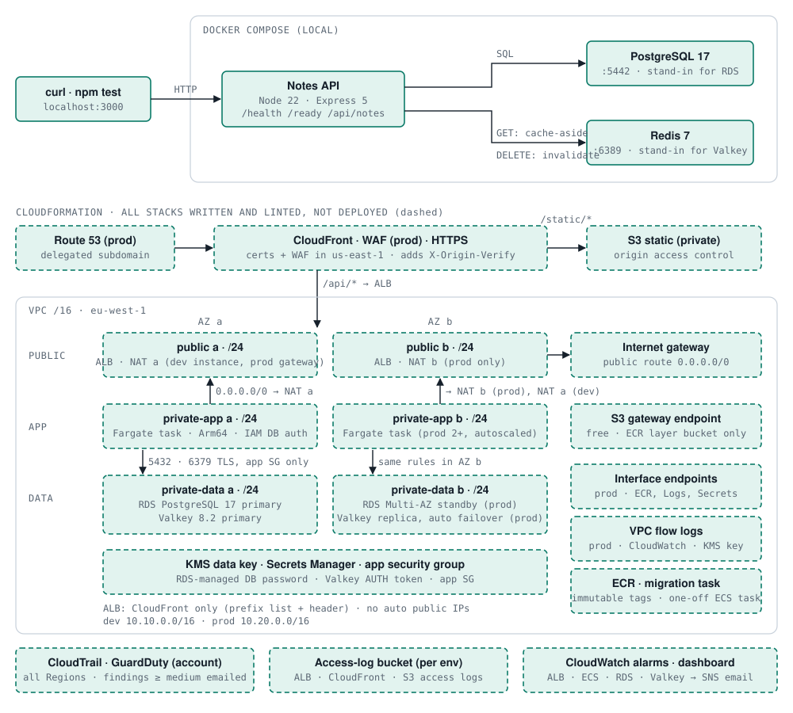

# aws-ha-web-platform

A highly available web platform on AWS, defined entirely in CloudFormation, running a small Node.js/Express API on ECS Fargate across two Availability Zones.

> **Status:** work in progress. Sections marked _TBD_ will be filled in as each stack is built. Every figure in this README (cost, deploy time, failover time) is measured, not estimated, and says how it was measured.

## Contents

- [Problem](#problem)
- [Architecture](#architecture)
- [Design decisions and trade-offs](#design-decisions-and-trade-offs)
- [Security](#security)
- [Observability](#observability)
- [Reliability testing](#reliability-testing)
- [Cost](#cost)
- [Run locally](#run-locally)
- [Repository layout](#repository-layout)
- [Deploy and teardown](#deploy-and-teardown)
- [CI/CD](#cicd)
- [What I'd do next](#what-id-do-next)

## Problem

I wanted a production-shaped reference platform for a stateless backend API, one that:

- survives the loss of a container, an instance or a whole Availability Zone without downtime;
- keeps the application and data off the public internet, with encryption at rest and in transit;
- is reproducible from code, deployable from CI without long-lived AWS credentials, and can be torn down completely in one command;
- tells me when something is wrong before a user does.

The API itself is deliberately small, so the focus stays on the infrastructure around it. It is a notes service in Node.js 22 and Express 5, backed by PostgreSQL with a Redis cache-aside layer:

| Method and path | Purpose |
|---|---|
| `GET /health` | Liveness for the ALB. Does not touch dependencies, so a database failover does not make the ALB drain every task. |
| `GET /ready` | Readiness: checks PostgreSQL (required) and Redis (optional). Returns 503 if the database is unreachable. |
| `POST /api/notes` | Create a note (`title`, optional `content`). |
| `GET /api/notes` | List recent notes (`?limit=`, max 100). |
| `GET /api/notes/:id` | Read a note through the cache. The `X-Cache: HIT|MISS` header shows which path served it. |
| `DELETE /api/notes/:id` | Delete a note and invalidate its cache entry. |

Behaviours that matter for the platform:

- **Redis is optional.** If ElastiCache is unavailable, requests fall through to PostgreSQL and a warning is logged. An integration test covers this.
- **Graceful shutdown.** On SIGTERM (sent by ECS when a task stops), the server stops accepting connections, finishes in-flight requests, and closes its pools.
- **Safe concurrent start-up.** Schema migrations run at start-up under a PostgreSQL advisory lock, so several tasks starting at once do not race.
- **Structured logs.** One JSON line per request on stdout, keyed by the ALB trace id when present.

## Architecture

### Built so far



Nothing is deployed to AWS yet. PostgreSQL and Redis stand in locally for RDS and ElastiCache. The network stack ([`infra/templates/network.yaml`](infra/templates/network.yaml)) and the data stack ([`infra/templates/data.yaml`](infra/templates/data.yaml)) are written and pass lint, but have not been deployed. This diagram is updated as each stack lands.

### Target

<!-- TBD: replace with a full-size exported diagram in docs/images/architecture.png -->


| Stack | Template | Contents |
|---|---|---|
| network | `infra/templates/network.yaml` | VPC, public / private / data subnets in two AZs, NAT Gateways, VPC endpoints, flow logs |
| data | `infra/templates/data.yaml` | KMS key, RDS PostgreSQL Multi-AZ, ElastiCache for Valkey, Secrets Manager secrets, app/database/cache security groups |
| compute | `infra/templates/compute.yaml` | ECR, ALB, ECS cluster and Fargate service, auto scaling, task and execution roles |
| edge | `infra/templates/edge.yaml` | CloudFront, WAF web ACL, ACM certificate, Route 53 records, S3 static bucket |
| security | `infra/templates/security.yaml` | CloudTrail, GuardDuty |
| observability | `infra/templates/observability.yaml` | CloudWatch dashboard, alarms, SNS topic |

## Design decisions and trade-offs

Prices quoted below are AWS on-demand list prices for eu-west-1, taken from the AWS Price List on 13 November 2026. They are not measured spend; that goes in [Cost](#cost) once the platform has run.

### Region

Everything runs in **eu-west-1 (Ireland)**, with one exception that AWS imposes: CloudFront only accepts an ACM certificate from **us-east-1**, and a WAF web ACL with `CLOUDFRONT` scope must also be created there. The edge stack therefore deploys that certificate and web ACL to us-east-1 and everything else to eu-west-1.

### Network (`infra/templates/network.yaml`)

- **Three subnet tiers in two AZs.** Public subnets hold only the ALB and the NAT Gateways. Private-app subnets hold the Fargate tasks. Private-data subnets hold RDS and ElastiCache and have **no default route at all**, so even a misconfigured database cannot reach the internet. Each tier gets a /24 per AZ, carved from a /16 with `Fn::Cidr`, which leaves room for more tiers later.
- **No public IPs by default.** No subnet sets `MapPublicIpOnLaunch`. The NAT Gateways use Elastic IPs and the ALB manages its own addresses, so nothing else can end up with a public IP by accident.
- **NAT: managed gateways in prod, one small NAT instance in dev** (`NatMode`, `NatCount`). A NAT Gateway costs $0.048/hour plus $0.048 per GB processed. A `t4g.nano` NAT instance costs $0.0046/hour plus $0.70 a month for its 8 GB gp3 disk, with no per-GB charge. Either way, each NAT needs a public IPv4 address at $0.005/hour, which makes the address the largest part of dev's network cost. The instance runs Amazon Linux 2023 and does NAT with a single iptables `MASQUERADE` rule set up in user data. It has no SSH key, no inbound SSH, IMDSv2 only and an encrypted disk, and I reach it through SSM Session Manager. What I give up in dev:
  - The instance is not self-healing. If it fails, the private-app subnets lose outbound internet until I replace it. Routes point at a fixed network interface rather than at the instance, so a replacement only needs that interface reattached.
  - Its bandwidth is that of a `t4g.nano`, which is plenty for test traffic.
  - I own its OS patching.

  In prod, `NatCount` 2 gives each AZ its own managed gateway, so losing an AZ only affects that AZ. With a single NAT in AZ a, losing AZ a would also cut outbound access for AZ b. Each private-app subnet has its own route table in every mode, so switching between modes or counts only changes route targets, and the Elastic IPs stay the same.
- **S3 gateway endpoint everywhere.** It is free, and ECR stores image layers in S3, so image pulls do not pay the NAT Gateway's per-GB charge. Its endpoint policy only allows `s3:GetObject` on the ECR layer bucket for the Region, because nothing else in the VPC needs S3.
- **Interface endpoints only in prod** (`EnableInterfaceEndpoints`). Fargate needs ECR (`ecr.api`, `ecr.dkr`), CloudWatch Logs and Secrets Manager. Four endpoints in two AZs cost 8 × $0.011 = $0.088/hour (about $64 a month) plus $0.01 per GB. The NAT instance that dev needs anyway already reaches those APIs, so in dev the endpoints would add cost without removing anything. On cost alone, they only pay off against NAT processing ($0.048 vs $0.01 per GB) above roughly 1.7 TB a month, far beyond this project's traffic. I enable them in prod for a different reason: image pulls, secret retrieval and log delivery stay on the AWS network, and do not depend on NAT.
- **Logging: full in prod, minimal in dev** (`LoggingMode`). In prod, VPC flow logs capture accepted and rejected traffic for the whole VPC into a CloudWatch Logs group with 365-day retention. The group is encrypted with a customer-managed KMS key ($1 a month, rotated yearly). Ingestion is the main variable cost at $0.57 per GB, so the aggregation interval stays at the default 10 minutes. The same key is exported for the application's log groups, so prod pays for one logs key rather than one per stack. Dev has no flow logs and no key: application logs use CloudWatch Logs' default encryption, which is free. Dev only carries my own test traffic, so I don't need flow logs there for investigation.
- **Cross-stack wiring through exports** named `<stack>-VpcId`, `<stack>-PrivateAppSubnetIds` and so on. The later stacks take the network stack name as a parameter and use `Fn::ImportValue`, and CloudFormation refuses to delete the network stack while anything still imports from it.

### Data (`infra/templates/data.yaml`)

At list prices, over a 730-hour month, the data stack comes to about **$26.68 a month in dev** (about $0.037/hour) and **$77.11 in prod** (about $0.106/hour). Together with the network stack, that is $34.39 in dev and $219.71 in prod.

- **PostgreSQL 17 on RDS: single-AZ `db.t4g.micro` in dev, Multi-AZ `db.t4g.small` in prod** (`DbInstanceClass`, `DbMultiAz`). The micro costs $0.017/hour single-AZ. The small costs $0.069/hour Multi-AZ: twice its single-AZ price, because the standby is a full second instance in the other AZ, kept in sync and promoted automatically if the primary or its AZ fails. gp3 storage is $0.127 per GB-month, or $0.254 for Multi-AZ, and 20 GiB is the minimum. For prod I passed over `db.t4g.micro` (1 GiB of memory, little for PostgreSQL) and the larger `db.t4g.medium` ($0.138/hour Multi-AZ) and `db.m7g.large` ($0.372/hour Multi-AZ), which are out of proportion for a demo that runs on credits. What I give up in dev is failover: if the instance or AZ a fails, the API is down until RDS recovers it. The t4g classes run in unlimited CPU-credit mode, so sustained load above the baseline is billed per surplus vCPU-hour ($0.075 or $0.09 in the price list).
- **TLS required, storage encrypted.** The parameter group sets `rds.force_ssl=1`, so plaintext connections are refused. The app verifies the server certificate against the RDS CA bundle in its image, and the instance pins `rds-ca-rsa2048-g1` to match. Storage, automated backups and Performance Insights data are encrypted with the data tier's KMS key.
- **No password in the template.** With `ManageMasterUserPassword`, RDS generates the master password, keeps it in a Secrets Manager secret encrypted with the data key ($0.40 a month) and rotates it every 7 days. ECS only injects secrets when a task starts, so after a rotation, new connections from running tasks would fail. The compute stack will have the app fetch the current password when it opens a connection (`pg` accepts a function for `password`) rather than reading it once from the environment. For now the app uses the master user; a separate, less privileged application role is on my list for the compute stack.
- **Backups and deletion differ per environment.** Dev keeps backups for 1 day, has no deletion protection, and the database is deleted with the stack. Prod keeps 7 days, has deletion protection on, and takes a final snapshot when the stack deletes or replaces the instance. Backup storage up to the size of the database is free, then $0.095 per GB-month. Choosing the `DeletionPolicy` from a parameter needs the `AWS::LanguageExtensions` transform, so this stack deploys with `CAPABILITY_AUTO_EXPAND`. When the policy is `Snapshot`, the KMS key is retained too, because the snapshot cannot be restored without it. After a prod teardown, that key keeps costing $1 a month until I schedule its deletion.
- **Monitoring.** Enhanced Monitoring sends OS metrics every 60 seconds in both environments. Its only cost is CloudWatch Logs ingestion ($0.57 per GB), which I will measure rather than guess. Prod also turns on Performance Insights with the free 7-day retention, and exports the PostgreSQL log to a log group the stack creates itself, with 90-day retention and the network stack's logs key. Statements slower than 1 second are logged.
- **ElastiCache for Valkey rather than Redis OSS.** Valkey speaks the same protocol, so the app's `redis` client needs no change, and a `cache.t4g.micro` node costs $0.0136/hour against $0.017 for Redis OSS (20% less). I use Valkey 8.2. Valkey Serverless would be cheaper for dev (its 100 MB minimum at $0.094 per GB-hour is about $6.86 a month), but it is a different resource with different behaviour. I prefer dev to run the same template as prod.
- **One cache node in dev, a primary and a replica in prod** (`CacheNodeCount`), on `cache.t4g.micro` either way. In prod the replica sits in the other AZ, and ElastiCache promotes it automatically if the primary fails. The cache only holds data derived from PostgreSQL, and the app treats it as optional, so losing the dev node costs latency, not availability. Prod keeps one daily snapshot; dev keeps none.
- **Cache TLS and AUTH.** In-transit encryption is set to `required` and at-rest encryption uses the data key. The AUTH token (64 letters and digits) is generated by Secrets Manager and passed to ElastiCache through a dynamic reference, so it never appears in the template or the parameters. The app connects with a `rediss://` URL, which makes the `redis` client use TLS. ElastiCache's certificate comes from Amazon's public CA, which Node already trusts. The token reaches the app as `REDIS_PASSWORD`, which ECS will inject from the secret. It cannot go into the URL secret, because that secret is created before the cache endpoint exists. I chose a single AUTH token over RBAC users because there is only one client. The token is not rotated automatically yet.
- **One KMS key for the whole data tier** ($1 a month, rotated yearly). It covers the database, the cache, both secrets and Performance Insights. It is separate from the network stack's logs key, whose policy only lets CloudWatch Logs use it. Each rotation adds a key version, billed at $1 a month, and AWS stops charging for new versions after the second rotation.
- **The app's security group lives in this stack.** The database and cache groups accept 5432 and 6379 only from the app group, and have no egress rules at all. The app group has to exist before those rules, and the compute stack does not exist yet, so this stack creates and exports it. The compute stack attaches it to the Fargate service and adds the ALB-to-app rule as a separate ingress resource. This stack defines no ingress on the app group, so the two stacks never manage the same rules. The app group's egress to 5432 and 6379 targets the VPC CIDR rather than the data groups. Referencing those groups would create a dependency loop, and it adds no exposure, because nothing but the app group is accepted on those ports.

### Planned

- **Fargate over EC2:** no instances to patch or bin-pack. The trade-off is a higher per-vCPU price and less control over the host.
- **CloudFront in front of the ALB:** TLS at the edge, caching, WAF at the edge, and an ALB that only accepts traffic from CloudFront.
- **CloudFormation over CDK/Terraform:** _TBD_

## Security

Summary here, detail in [SECURITY.md](SECURITY.md). _TBD_

## Observability

_TBD: dashboard screenshot, alarm list, log format._

## Reliability testing

_TBD: documented tests for (1) stopping a running task, (2) forcing an RDS Multi-AZ failover, with measured results._

## Cost

_TBD: measured monthly cost per environment, with the AWS Pricing Calculator link and Cost Explorer figures._

## Repository layout

```
app/                    Node.js/Express API and Dockerfile
infra/templates/        CloudFormation templates, one per stack
infra/parameters/       Parameter files per environment (dev, prod)
scripts/                deploy, destroy and lint scripts used by make and CI
docs/                   Diagrams, screenshots, runbooks
.github/workflows/      CI/CD pipelines
```

## Run locally

Needs Docker and Node.js 22. PostgreSQL and Redis run in containers on ports 5442 and 6389, so they do not clash with local installs.

```sh
docker compose up -d --wait               # PostgreSQL and Redis
cd app && npm ci && npm test              # lint separately with: npm run lint
docker compose --profile app up --build   # API on http://localhost:3000
```

## Deploy and teardown

_TBD._ The intended interface:

```sh
make lint                 # cfn-lint + Checkov on all templates
make deploy ENV=dev       # deploy every stack in order
make destroy ENV=dev      # delete every stack in reverse order
```

On Windows without `make`, use the scripts directly, e.g. `bash scripts/deploy.sh dev`.

## CI/CD

_TBD: GitHub Actions with OIDC role assumption, no stored access keys._

## What I'd do next

_TBD: multi-region active/passive, blue/green deployments with CodeDeploy, EKS variant._

## Licence

[MIT](LICENSE)
