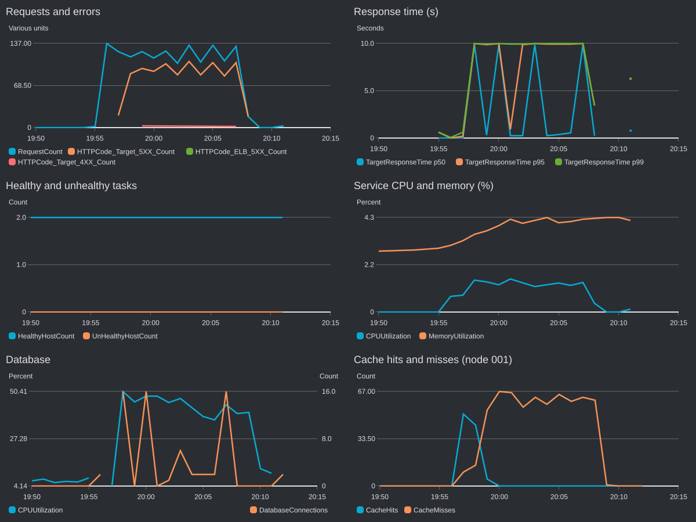

# A database failover that took seconds and cost minutes

*What I learnt deploying a highly available web platform to a real AWS account, failing it on purpose, and tearing it down again. November 2026.*

I built [aws-ha-web-platform](../README.md) to practise the parts of backend work that only show up on real infrastructure: networks, failover, permissions, cost. It is a small notes API in Node.js on ECS Fargate across two Availability Zones, behind CloudFront and WAF, with PostgreSQL on RDS Multi-AZ and a Valkey cache with a replica. Everything is CloudFormation, deployed by one script, from my laptop or from GitHub Actions through OIDC.

The design took most of the time. This write-up is about what happened once it ran. Every number here was measured, and the full log, with commands and timestamps, is in [measurements.md](measurements.md).

## The rules I set myself

- **Short sessions, then tear everything down.** The account runs on $180 of AWS Free plan credits, so I deployed for an hour or two at a time, measured what I wanted, and deleted every stack. After each teardown I listed every billable resource type in both Regions to check nothing was left.
- **Only measured numbers.** Prices in the README's design section are dated list prices. Everything about deploy times, latency, failover and spend is measured and dated, including the runs that went wrong.
- **No long-lived keys.** I sign in with `aws login` (console credentials and MFA). CI uses GitHub OIDC and assumes a role that can only drive CloudFormation through an execution role, inside a permissions boundary.

## What the account refused

The AWS Free plan turned out to be a constraint in its own right:

- **GuardDuty:** `SubscriptionRequiredException`. The security stack takes `GUARDDUTY=disabled`; CloudTrail, flow logs and the WAF and access logs still run.
- **EC2 types that are not Free Tier eligible.** Dev's NAT instance moved from `t4g.nano` to `t4g.micro`.
- **`db.t4g.small` and more than one day of backups.** Each refusal came after the data stack had spent about 11 minutes creating and rolling back. I added deploy-time overrides rather than changing prod's committed design, and ran prod on a Multi-AZ `db.t4g.micro`, which the plan accepted.
- **IAM Identity Center.** Enabling it with AWS Organizations upgrades the account and forfeits the credits, so SSO was out.

## Bugs that only a real deploy found

Linting (cfn-lint, Checkov, ShellCheck) and local tests passed throughout. These did not show up until AWS ran the code:

1. A log-stream permission that matched nothing: `!GetAtt LogGroup.Arn` already ends in `:*`, so appending `:log-stream:*` produced an ARN no stream has.
2. `ADD --chmod=444` in the Dockerfile also gave the directory it created mode 444, so the migration task could not read the RDS CA bundle.
3. CloudFront replaces an origin's `X-Cache` header with its own. The app's cache header became `X-App-Cache`.
4. GitHub issues this repository *immutable* OIDC subjects, which carry the owner and repository IDs. STS refused the role trust I had written in the older `repo:owner/name` form.
5. Two permissions the least-privilege roles lacked: CloudFormation expands the `AWS::LanguageExtensions` transform as the stack's service role, and RDS passes the Enhanced Monitoring role itself, so `iam:PassedToService` is `rds.amazonaws.com`.
6. The Windows AWS CLI ends lines with CRLF, and Bash kept the CR, which broke a Route 53 change batch in the prod teardown. `lib.sh` now strips it from all CLI output.
7. `update-stack --use-previous-template` answers *"No updates are to be performed"* on a stack that uses the `AWS::LanguageExtensions` transform, even when a parameter changes. The teardown now sends the repository's template.

Every one of them had passed every check I could run before deploying.

## Failing it on purpose

I ran three failure tests against prod on 17 November 2026, and repeated the database one that evening, each with a k6 script sending requests through CloudFront from my laptop in Lisbon and recording every response:

| Failure | Back to normal (AWS's view) | What clients saw |
|---|---|---|
| One of two Fargate tasks stopped | Replacement healthy after 58 s | 0 errors in 658 requests |
| Valkey primary failed over to the replica | 22 s | 0 errors in 687 requests; 34 s of reads served from PostgreSQL |
| RDS Multi-AZ failover, run 1 | **29 s** | Database requests failed for **about 6 minutes** |
| RDS Multi-AZ failover, run 2 | **48 s** | Database requests failed for **11 to 14 minutes** |

The first two did what the design said. The ALB health check calls `/health`, which never touches a dependency, and the app treats the cache as optional, so neither failure reached a client.

### Why 29 seconds became six minutes

The API never holds a database password. It signs in as a restricted user with IAM database authentication: each new connection signs a 15-minute token with the task role's credentials, and RDS checks it. I chose that to keep long-lived secrets out of the service.

After RDS promoted the standby, the new primary's PostgreSQL log showed its IAM authentication service, `rdsauthproxy` on port 1108, first refusing connections and then answering `403 Forbidden` to tokens that were valid before and after. Logins waiting on it held connection slots until they timed out, so other connections were turned away with *"sorry, too many clients already"*. RDS reported the failover complete at 29 s. The app's database requests failed from 4 s after the failover started until about 6 minutes later, when sign-ins began working again without anyone touching it. The `prod-api-5xx` alarm fired 3 min 20 s after the first error.

I deployed prod again later the same day and repeated the test. RDS reported the failover complete after 48 s. The new primary rejected the app's IAM sign-ins with the same `pam_authenticate failed: Permission denied`, and this time database requests failed for between 11 and 14 minutes. I can only bound it, because nothing tried to sign in during the last few of those minutes. Both tasks stayed healthy throughout, because `/health` does not touch the database:

*Prod dashboard, 19:50 to 20:15 UTC on 17 November 2026, rendered from the dashboard's widgets with CloudWatch `GetMetricWidgetImage`. The load ran from 19:56 to 20:08, so the drop after 20:08 is the load ending, not the recovery.*

Two runs, the same cause, and six minutes in one against eleven to fourteen in the other. The length is the problem: I cannot predict it, so I cannot plan around it.

So the choice that kept passwords out of the service cost minutes of downtime in exactly the event Multi-AZ is for. I still think IAM authentication is the right default, but it has to be paired with something that rides out a failover: RDS Proxy, which holds the database connections and can take the IAM sign-ins, or backoff in the app while sign-ins fail. ### The fix

I wrote the RDS Proxy version first. The AWS Free plan refused to create the proxy: *"This feature isn't available with free plan accounts."* So I added the option the account does allow: the service signs in with a generated password that ECS injects from Secrets Manager, and the database never sees an IAM token.

On 18 November I deployed dev with a Multi-AZ `db.t4g.micro`, the same database as prod, and forced two failovers under the same k6 load:

| Sign-in | Runs | RDS failover | App errors |
|---|---|---|---|
| IAM (prod, 17 November) | 2 | 29 s, 48 s | about 6 min, 11-14 min |
| Password (dev, 18 November) | 2 | 35 s, 45 s | **23 s, 22 s** |

What is left is the database's address moving: for about 20 seconds the app still tried the old primary and got `ECONNREFUSED`. That is the cost of DNS-based failover, and RDS Proxy is meant to hide it too.

The trade-off is real. The service now holds a password, not rotated automatically yet, where before it held nothing. I took the twenty seconds. The proxy, written and linted but not deployed, would keep IAM for the service and the password with the proxy, on an account that allows it.

## The WAF test I did not plan

My first task-stop run sent 10 requests a second, which is over the WAF rate rule of 1,000 requests per IP per 5 minutes. After 1,408 requests in 128 seconds, WAF started answering `403` to my laptop, 2,337 times in all, and its `BlockedRequests` metric matched k6's count to within one. The block lifted between 34 s and 4 minutes after the load stopped. The later tests ran at 2 requests a second.

## Latency

From Lisbon to dev through CloudFront, at a steady 5 requests a second for 2 minutes: p50 55 ms, p95 89 ms, p99 110 ms, 693 requests, none failed. That is what one client sees at a low rate, not a capacity figure. The first IAM-authenticated connection from a new task took 7.2 to 7.4 seconds, longer than the original 5-second connect timeout, which explained the slow first `/ready` in dev. The app now opens that connection at start-up.

## What it cost

Not known yet, and I will not guess. After four sessions, about 7 hours of deployed time in all, the credit balance read $178.79 at 20:46 UTC on 17 November, down from $180. AWS billing lags by hours, so that is not the final figure. I will add the real spend here, and in [measurements.md](measurements.md), once billing has caught up.

One cost I did find: my first prod session left two KMS keys enabled after the Free plan rolled back two database attempts, at $1 a month each. My leftover check after that session missed them, and the check after the next one found them.

## What I would do differently

- **Test failover before trusting it.** The design reviews, the linters and the local tests all agreed the database tier was highly available. One forced failover showed a six-minute gap that none of them could, and two more showed what fixed it.
- **Deploy early, even a skeleton.** Most of the bugs above were small fixes, and I would rather have found them while writing each template than all at the end.
- **Check the account's limits first.** Two of the Free plan's refusals each cost an 11-minute create and rollback of the data stack.
